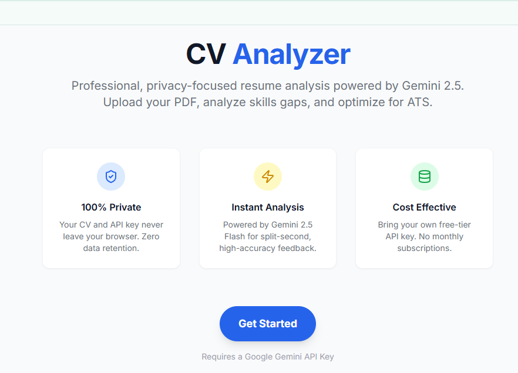
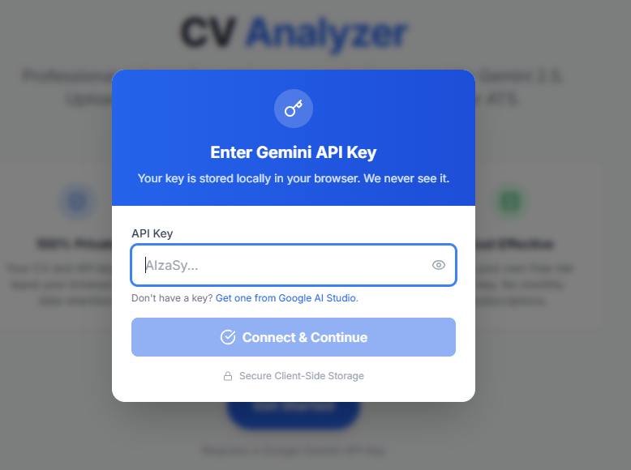
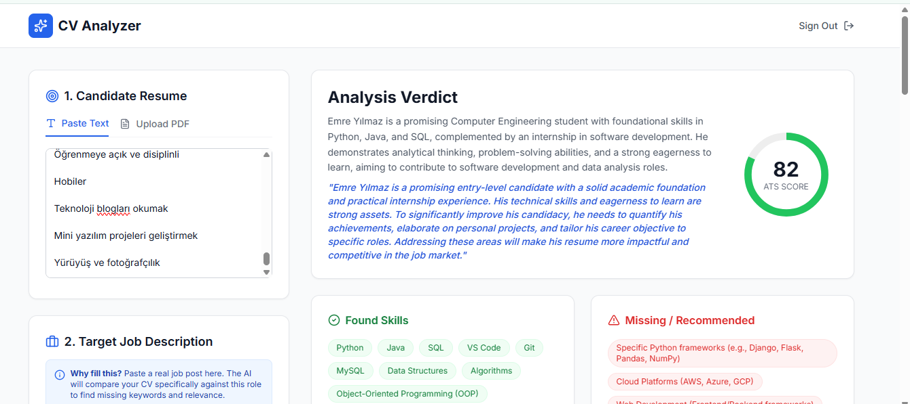
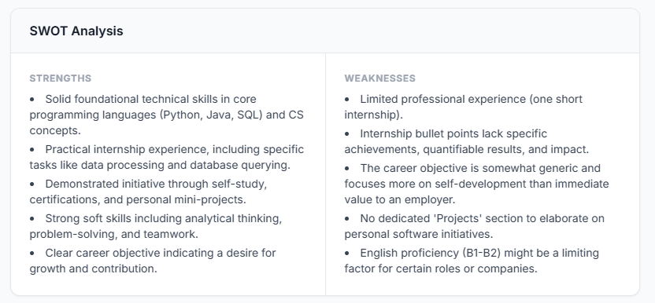
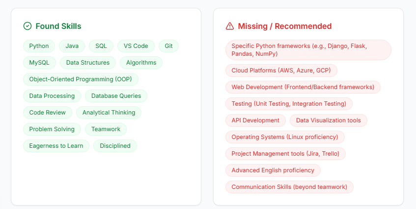
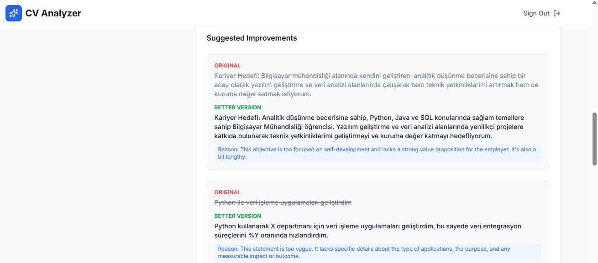

# AI Destekli CV Analyzer

Bu proje, yapay zeka destekli bir **CV / Özgeçmiş analiz uygulamasıdır**. Kullanıcıdan alınan API anahtarı ile çalışır ve CV'leri modern ATS (Applicant Tracking System) kriterlerine göre değerlendirir.

Amaç; adaylara CV'lerini daha **okunaklı, etkili ve işe alım sistemleriyle uyumlu** hale getirmeleri için somut geri bildirimler sunmaktır.




---


## 🚀 Özellikler

* CV formatı ve okunabilirlik analizi
* Güçlü ve zayıf yönlerin tespiti (SWOT)
* Eksik anahtar kelimelerin belirlenmesi
* ATS uyumluluk skoru (0–100)
* CV maddeleri için yeniden yazılabilir öneriler
* **API key repoda tutulmaz** – kullanıcıdan çalışma anında alınır

---

* **API key repoda tutulmaz** – kullanıcıdan çalışma anında alınır


---
* CV formatı ve okunabilirlik analizi- ATS uyumluluk skoru (0–100)


---
* Güçlü ve zayıf yönlerin tespiti (SWOT)


---
* Eksik anahtar kelimelerin belirlenmesi


---
* CV maddeleri için yeniden yazılabilir öneriler



---
## 🧠 Kullanılan Teknolojiler

* React + TypeScript
* Vite
* Google Gemini API (AI Studio)
* Modern component-based mimari

---

## 🛠️ Local'de Çalıştırma

### Gereksinimler

* Node.js 

### Kurulum Adımları

1. Bağımlılıkları yükleyin:

   ```bash
   npm install
   ```

2. Uygulamayı başlatın:

   ```bash
   npm run dev
   ```

3. Tarayıcıdan görüntüleyin:

   ```
   http://localhost:5173
   ```

> 🔐 **API Key Kullanımı:**
> Bu projede API anahtarı `.env` dosyasında tutulmaz. Uygulama açıldığında kullanıcıdan güvenli şekilde alınır.

---

## 🔒 Güvenlik Notu

* API anahtarları GitHub reposunda **yer almaz**
* Kullanıcıdan runtime sırasında alınır
* Open-source ve güvenli kullanım hedeflenmiştir

---

## 📌 Notlar

* Bu proje AI destekli geliştirme süreci kullanılarak hazırlanmıştır
* Kod organizasyonu ve mimari kararlar geliştirici tarafından yapılmıştır

---

## 👤 Geliştirici

Bu proje, staj ve junior pozisyonlara yönelik bir portföy çalışması olarak geliştirilmiştir.

Her türlü geri bildirim ve öneriye açıktır ✨
